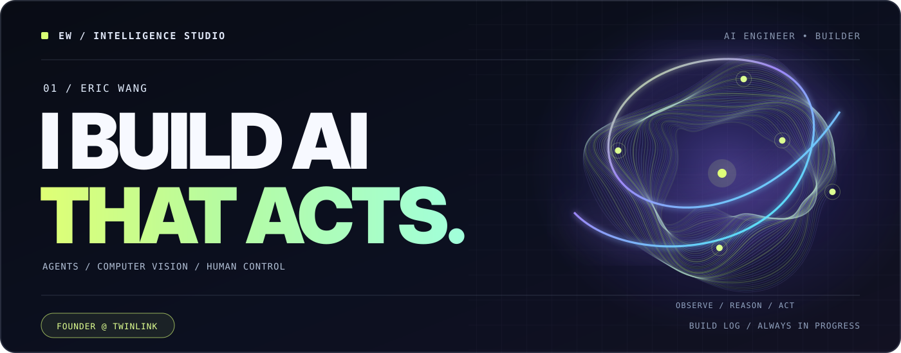

<!-- Eric Wang · GitHub Profile README -->

  

  <a href="https://twinlink.tech">Website ↗</a> &nbsp;&nbsp;·&nbsp;&nbsp;
  <a href="mailto:eric.wang.swe@outlook.com">Get in touch ↗</a> &nbsp;&nbsp;·&nbsp;&nbsp;
  <a href="https://github.com/ericwangAISavy?tab=repositories">Explore my work ↗</a>

 

### HELLO, I'M ERIC.

I’m an **AI engineer** and the **founder of [Twinlink](https://twinlink.tech)**. I’m interested in the point where intelligent models become useful software: systems that can understand an interface, make decisions, and help people get meaningful work done.

My focus is on **AI agents**, **human-in-the-loop automation**, and **thoughtful product engineering**. I like ambitious ideas, but I care just as much about the details that make them reliable, usable, and real.

 

### 01 / WHAT I'M EXPLORING

| | Direction | The question I'm working on |
| :-- | :-- | :-- |
| `01` | **Computer-use agents** | How can AI operate real interfaces safely and predictably? |
| `02` | **Human-centered AI** | How do we make autonomy useful without losing human control? |
| `03` | **Product systems** | How can sophisticated technology feel effortless to use? |

 

### 02 / SELECTED WORK

<table>
  <tr>
    <td width="50%" valign="top">
      <h3><a href="https://github.com/ericwangAISavy/Monster">↗ Monster</a></h3>
      
<b>AI computer-use agent · experimental</b>

      
Exploring visual desktop understanding, supervised computer control, and local-model integration. The project includes early companion and computer-tool prototypes.

      
<code>Python</code> <code>PySide6</code> <code>Ollama</code>

    </td>
    <td width="50%" valign="top">
      <h3><a href="https://github.com/ericwangAISavy/twinlink">↗ Twinlink</a></h3>
      
<b>Technology platform · product development</b>

      
A technology consulting site and talent portal, with application flows, role-based experiences, and operational tooling.

      
<code>Next.js</code> <code>TypeScript</code> <code>Supabase</code>

    </td>
  </tr>
  <tr>
    <td width="50%" valign="top">
      <h3><a href="https://github.com/ericwangAISavy/FrameForge">↗ FrameForge</a></h3>
      
<b>Interactive engineering portfolio</b>

      
An editorial gameplay-engineering showcase featuring systems experiments, engineering studies, and interactive storytelling.

      
<code>React</code> <code>TypeScript</code> <code>Next.js</code>

    </td>
    <td width="50%" valign="top">
      <h3><a href="https://github.com/ericwangAISavy/jobScraping">↗ Job Scraper</a></h3>
      
<b>Developer utility</b>

      
A server-side careers-page discovery tool with filtering, metadata extraction, and Markdown export.

      
<code>Next.js</code> <code>Cheerio</code> <code>TypeScript</code>

    </td>
  </tr>
</table>

 

### 03 / TOOLS I WORK WITH

**AI & automation** &nbsp; `Python` · `Ollama` · `Vision-language models` · `PySide6`  
**Product engineering** &nbsp; `TypeScript` · `React` · `Next.js` · `Tailwind CSS`  
**Data & delivery** &nbsp; `Supabase` · `PostgreSQL` · `Vercel`

 

### 04 / HOW I THINK

> **Intelligence should become action — with people still in control.**
>
> Good engineering makes powerful technology understandable, dependable, and genuinely useful.

 

---

  <strong>Interested in AI agents, useful products, or the next good idea?</strong>  
  <a href="mailto:eric.wang.swe@outlook.com"><b>Let's connect ↗</b></a>
  &nbsp;&nbsp;·&nbsp;&nbsp;
  <a href="https://twinlink.tech">Twinlink ↗</a>

ERIC WANG &nbsp; / &nbsp; ENGINEERING INTELLIGENCE

