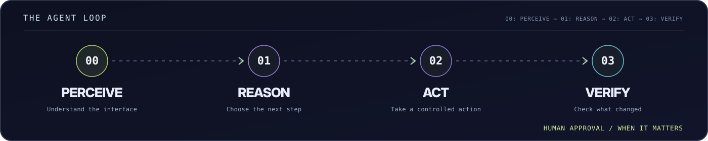
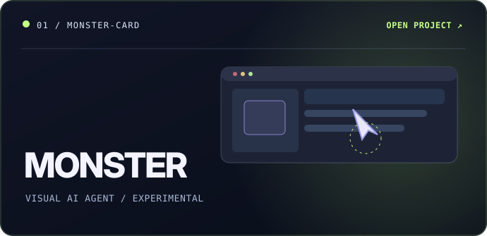
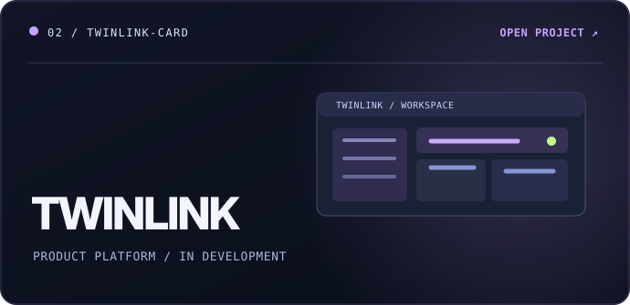
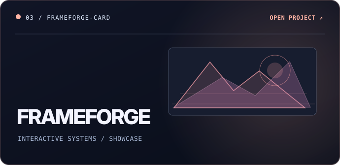
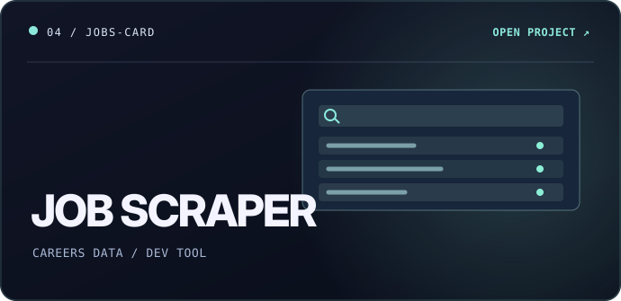
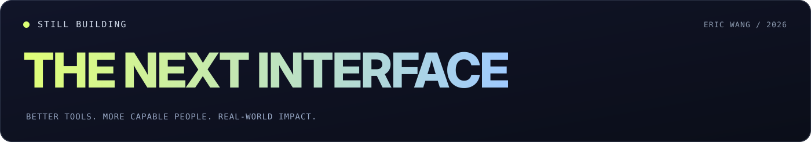

<!--
  ERIC WANG / AI ENGINEER
  GitHub profile — no external widgets, no tracking, no fragile generated statistics.
  All artwork is self-contained SVG stored in ./assets.
-->

  

  <a href="https://github.com/ericwangAISavy/Monster"><b>EXPLORE THE AGENT ↗</b></a>
  &nbsp;&nbsp; / &nbsp;&nbsp;
  <a href="https://twinlink.tech"><b>TWINLINK ↗</b></a>
  &nbsp;&nbsp; / &nbsp;&nbsp;
  <a href="mailto:eric.wang.swe@outlook.com"><b>GET IN TOUCH ↗</b></a>

 

## Hey, I’m Eric. 👋

**AI engineer. Product builder. Founder of [Twinlink](https://twinlink.tech).**

I’m interested in a world where software doesn't just respond — it can **perceive, reason, and help people take action**. My work lives at the intersection of **AI agents**, **computer-use systems**, and **human-centered products**.

I like ambitious engineering, clean interfaces, and keeping humans firmly in control of the important decisions.

 

### <code>01 / THE OBSESSION</code> &nbsp; From intelligence to action

Not another chatbot. I’m exploring systems that can understand what’s on a screen, plan a next step, act through real interfaces, and verify what actually happened.

  

### <code>02 / BUILT &amp; BUILDING</code> &nbsp; Selected work

<table>
<tr>
<td width="50%" valign="top">

 <b>Computer-use, with guardrails.</b> 
Early-stage Windows agent work: computer tools, local/LAN model previews, supervised actions, and safety controls.  
<code>Python</code> <code>PySide6</code> <code>Ollama</code>
</td>
<td width="50%" valign="top">

 <b>Engineering the company behind the ideas.</b> 
Technology and talent platform with candidate applications, role-based experiences, and team operations.  
<code>Next.js</code> <code>TypeScript</code> <code>Supabase</code>
</td>
</tr>
<tr>
<td width="50%" valign="top">

 <b>Interaction is an engineering problem.</b> 
Interactive engineering portfolio: systems studies, gameplay experiments, and story-driven interfaces.  
<code>React</code> <code>TypeScript</code> <code>Next.js</code>
</td>
<td width="50%" valign="top">

 <b>Less hunting. More signal.</b> 
Server-side careers-page discovery, structured job data extraction, filtering, and Markdown export.  
<code>Next.js</code> <code>Cheerio</code> <code>TypeScript</code>
</td>
</tr>
</table>

 

### <code>03 / MY TOOLKIT</code> &nbsp; What I reach for

| &nbsp; | &nbsp; |
| :--- | :--- |
| **Intelligent systems** | `Python` · `Vision-language models` · `Ollama` · `AI agents` |
| **Interfaces &amp; products** | `TypeScript` · `React` · `Next.js` · `Tailwind CSS` |
| **Desktop &amp; infrastructure** | `PySide6` · `PostgreSQL` · `Supabase` · `Vercel` |

 

### <code>04 / THE PRINCIPLE</code> &nbsp; Powerful technology should feel human

> **Give machines more capability. Give people more control.**
>
> The hard part isn't making a demo look intelligent. It's building something understandable, trustworthy, and genuinely useful.

  
<b>↳ Open my build philosophy</b>

   
  <code>observe → reason → act → verify</code>
    
  Great agents need more than models: they need boundaries, feedback, recoverability, and good interfaces. That's the problem I like working on.

 

  <a href="https://twinlink.tech">twinlink.tech</a>
  &nbsp;&nbsp; • &nbsp;&nbsp;
  <a href="https://github.com/ericwangAISavy?tab=repositories">All repositories</a>
  &nbsp;&nbsp; • &nbsp;&nbsp;
  <a href="mailto:eric.wang.swe@outlook.com">Email</a>

MADE TO BUILD — NOT JUST TO LOOK GOOD.

